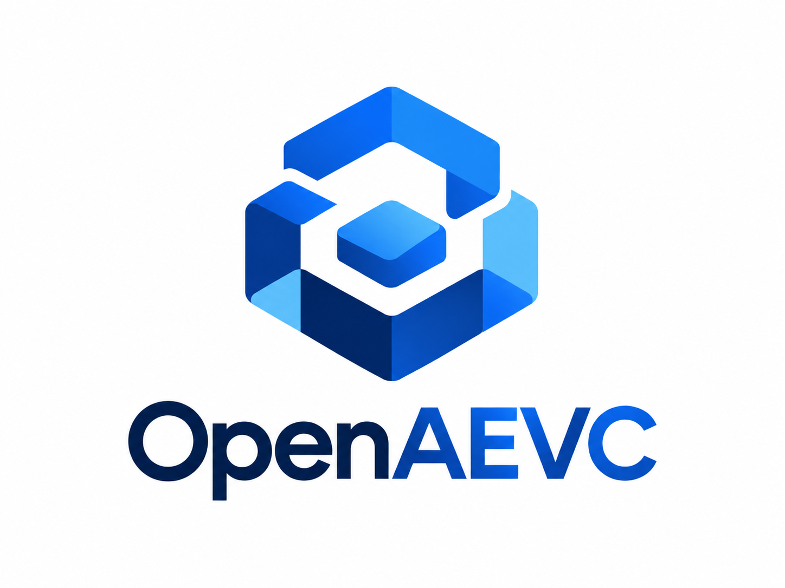

<!--
  OpenAEVC README

  Repo-ready assets expected under ./assets:
  - assets/open-aevc-head-logo.png
-->

<p align="center">
  
</p>

<h1 align="center">OpenAEVC</h1>

<p align="center">
  <strong>The open protocol and runtime for controlled change.</strong><br/>
  <em>Domain-neutral authority, execution, verification and composition for changes produced by humans or machines.</em>
</p>

**OpenAEVC** is a protocol and a reference runtime for accepting change under explicit authority. Anything that proposes change — a person, an agent, a CI job — works inside a **ChangePack**: executions apply effects through extensions, evidence and verification results bind to an exact sealed generation, policy gates qualify it, and promotion freezes it into an immutable, signed, content-addressed record. Accepted state is a set of immutable **Baselines** composed from promoted packs.

**It is not** a version-control system, a CI server, an agent framework or a workflow product. It knows nothing about files or source code: domains (key-value stores, documents, infrastructure, …) are added by out-of-process extensions.

## Architecture

```text
 consumers (SDKs: Rust · TypeScript · Python · Go)      extensions (any language, stdio)
        │ signed envelopes (embedded or HTTP)                  ▲ canonical CBOR frames
        ▼                                                      │
 ┌──────────────────────────── runtime ────────────────────────┴──────────┐
 │ admission: version → signature → freshness → replay → capability      │
 │ Active Change Graph   │  Accepted Composition  │  Immutable Object Store│
 │ (packs, work, leases) │  (promoted packs,      │  (sha256, Ed25519,     │
 │                       │   Baselines)           │   hash-chained events) │
 └────────────────────────────────────────────────────────────────────────┘
```

## Embedded

```rust
let pack = client.create_change_pack(PackSpec::default()).await?;
client.seal(pack, 1).await?;
client.refresh_qualification(pack, 1).await?;
let promoted = client.promote(pack, 1).await?;          // immutable, signed
let (_, baseline) = client.create_baseline(vec![promoted], vec![]).await?;
```

`EmbeddedClient` and `RemoteClient` share one trait and one admission path; see [`examples/`](examples/README.md).

## Daemon

```sh
openaevcd init --data-root ./data --config-out openaevcd.toml --admin-key-out admin.json
openaevcd run --config openaevcd.toml        # listens on ./data/openaevcd.sock; [listen] adds TCP/TLS
openaevc-inspect compatibility unix:./data/openaevcd.sock
```

## Extension

```rust
impl Extension for Counter {
    fn manifest(&self) -> ExtensionManifest { /* kinds, capabilities, self digest */ }
    fn handle(&mut self, op: Operation, host: &mut HostContext<'_>) -> Result<Value, WireError> {
        /* validate_effect · apply_effect · verify · evaluate · compose */
    }
}
fn main() -> std::process::ExitCode { serve(Counter) }
```

Register it with a pinned digest (`RegisterExtension`), then check it with `openaevc-conformance --target extension --extension ./counter`.

## Specification and conformance

- [`spec/`](spec/README.md) — the normative protocol (every normative MUST has a requirement ID).
- [`spec/conformance.md`](spec/conformance.md) — profiles CORE, AUTHORITY, RUNTIME, EXTENSION_HOST, FULL; `openaevc-conformance --profile FULL --target remote --endpoint … --admin-key …`.
- [`docs/`](docs/architecture/README.md) — architecture, SDKs, extension authoring, operations, ADRs.

Apache-2.0. See [CONTRIBUTING.md](CONTRIBUTING.md), [SECURITY.md](SECURITY.md) and [COMPATIBILITY.md](COMPATIBILITY.md).
